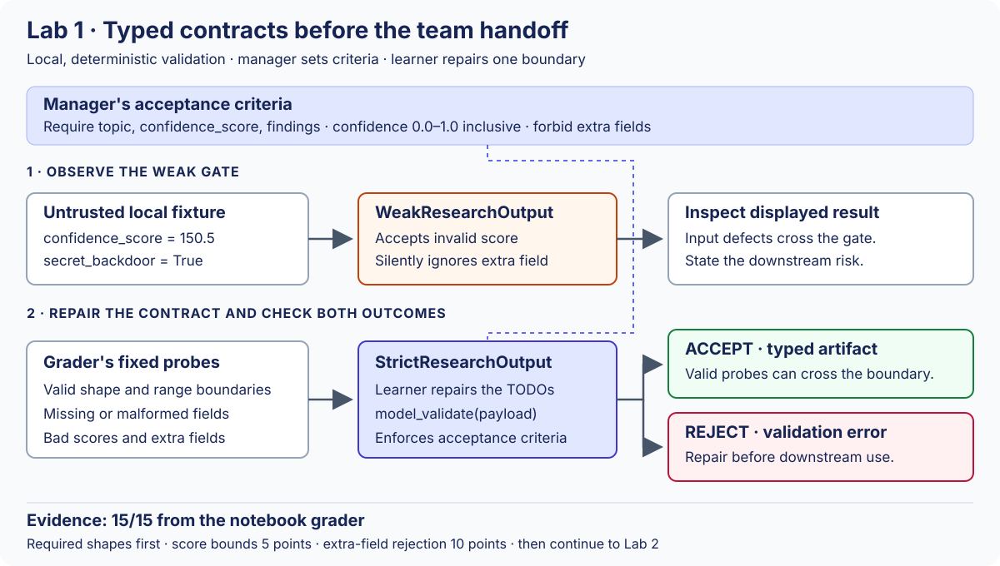
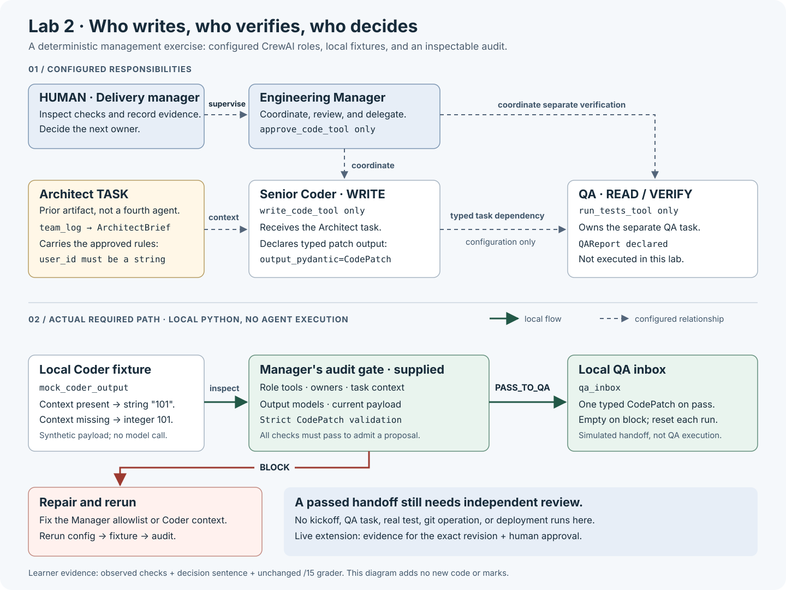

# Managing Multi-Agent Teams: Master Hub


**UN Volunteers · Course**

Supervise an agent team through typed handoffs, scoped tools, independent checks, and human decisions. The course starts with deterministic fixtures and ends with a Software Factory that builds a minimalist travel website using actual local files and Git operations. No LLM or reasoning model is called; no API key is required and actual API cost is **$0.00**.

Use this page as the course entry point. Assignment briefs live in one [assignment book](ASSIGNMENTS.md); teaching, grading, and Q&A live in one [instructor playbook](INSTRUCTOR_PLAYBOOK.md). Original documents are retained in the [documentation archive](_archive/documentation_before_hub/README.md).

[Golden path](#golden-path) · [Course topics](#course-topics) · [Assignments](ASSIGNMENTS.md) · [Assessment](#runtime-and-assessment) · [Personal resources](#personal-resources) · [Architecture](#architecture-and-design-decisions) · [Slide index](#main-deck-slide-index)

<a id="golden-path"></a>
<a id="navigation-dashboard"></a>
<a id="required-practical-sequence"></a>
<a id="click-through-course-journey"></a>
<a id="learner-paths"></a>
<a id="start-here"></a>

## Table of contents: the golden path

Read [Setup](SETUP.md), open JupyterLab from the repository root, and run notebooks in order. Predict the failure, repair the marked control, rerun dependent cells, then explain the evidence. All seven notebooks include an embedded exercise diagram and a Run / Edit / Inspect / Finish guide; no extra diagram-rendering package is needed. Notebook outputs are cleared for distribution; their Markdown and code cells are included.

| Phase | Open | Brief, diagram, or completion evidence |
| --- | --- | --- |
| Start | [00 · Preflight](notebooks/00_sandbox_preflight.ipynb) | [Environment setup](SETUP.md) · [six-slide main deck](slides/managing_multi_agent_teams_6_slides.pptx) |
| Core governance | [01 · Typed contracts](notebooks/01_lab_pydantic.ipynb) | [Assignment 03](ASSIGNMENTS.md#assignment-03-architectural-supervision) · [Contract diagram](resources/diagrams/lab1-contract-flow.svg) · raw grader 15/15 |
| Core governance | [02 · Team oversight](notebooks/02_lab_crewai.ipynb) | [Assignment 04](ASSIGNMENTS.md#assignment-04-code-auditing) · [Skill Transparency Matrix](ASSIGNMENTS.md#assignment-04-code-auditing-skill-transparency--least-privilege) · [Team diagram](resources/diagrams/lab2-team-audit.svg) · raw grader 15/15 |
| Core governance | [03 · Security gates and bounded repair](notebooks/03_lab_security.ipynb) | [Assignment 06](ASSIGNMENTS.md#assignment-06-code-validation) · unsafe input blocked, attempts bounded, escalation recorded |
| Capstone | [04 · Development-to-Security handoff](notebooks/04_capstone.ipynb) | [Capstone brief and ADR](ASSIGNMENTS.md#ex5-capstone-virtual-software-company) · [Concrete ERD](resources/diagrams/capstone_factory_erd.md) |
| Software Factory | [05 · Deterministic collaboration](notebooks/05_live_software_factory.ipynb) | [Execution guide](extensions/live_software_factory.md) · [Architecture](resources/diagrams/live-software-factory.svg) · candidate revision, six fixture decisions, eight QA checks |
| Local CI/CD | [06 · Release gates](notebooks/06_local_cicd.ipynb) | [Broken-pipeline exercise](extensions/live_software_factory.md#exercise-fix-the-broken-pipeline) · missing approval and stale evidence block publication |
| Submit | [Submission checklist](#submission-checklist) | [All assignment briefs](ASSIGNMENTS.md) · [Assessment /100](#runtime-and-assessment) |

For exact cell IDs, dependent reruns, and grader coverage, use the [technical course map](COURSE_MAP.md). After Lab 2, the optional [CrewAI bridge notebook](crewai_learning/01_Bridge_Sequential_Crew.ipynb) imports [coding_team.py](crewai_learning/coding_team.py) and executes real CrewAI tasks with scripted local adapters. It includes explicit Crew creation, execution, Markdown results, and exception-policy examples. Follow the [guided exercise](ASSIGNMENTS.md#assignment-09-guided-bridge-exercise) and [reference setup](crewai_learning/README.md); this adds no marks or submission.

<a id="course-overview"></a>
<a id="learning-outcomes"></a>

## Course outcomes

You will define a checkable task, validate typed artifacts before handoff, compare actual tools with a role allowlist, and bound failed attempts. At the team boundary, you will inspect separate Security evidence before permitting the next action. In the factory, you will connect reviews, simulated spending, and approval to the candidate revision, then distinguish a local published file from a hosted deployment.

The same four learning stages recur: contracts, team oversight, bounded controls, and a Development-to-Security Capstone. Factory and CI/CD labs apply them to a travel-site release. Procurement and HR/RAG are formative scenarios; they add no graded implementation.

<a id="course-topics"></a>
<a id="interactive-syllabus-nine-un-mandated-lectures"></a>

## Interactive syllabus: nine course topics

| Topic | Practice |
| ---: | --- |
| 1 · Strategic prompt engineering | [Checkable specification](ASSIGNMENTS.md#assignment-01-strategic-prompt-engineering) |
| 2 · Workspace and role context | [Role-aware workspace](ASSIGNMENTS.md#assignment-02-ai-workspace-and-role-context) |
| 3 · Typed context contracts | [Lab 1](notebooks/01_lab_pydantic.ipynb) · [Assignment 03](ASSIGNMENTS.md#assignment-03-architectural-supervision) |
| 4 · Tools and bounded control flow | [Lab 3](notebooks/03_lab_security.ipynb) |
| 5 · Code auditing and ownership | [Lab 2](notebooks/02_lab_crewai.ipynb) · [Skill matrix](ASSIGNMENTS.md#assignment-04-code-auditing-skill-transparency--least-privilege) |
| 6 · Validation and evaluation | [Lab 3 brief](ASSIGNMENTS.md#assignment-06-code-validation) · [Factory security](notebooks/05_live_software_factory.ipynb) |
| 7 · Context and access lists | [Authorized context selection](ASSIGNMENTS.md#assignment-07-context-engineering-access-lists) |
| 8 · Debugging and SDLC | [Trace diagnosis](ASSIGNMENTS.md#assignment-08-debugging-sdlc) · [CrewAI bridge exercise](ASSIGNMENTS.md#assignment-09-guided-bridge-exercise) · [Local CI/CD](notebooks/06_local_cicd.ipynb) |
| 9 · Managed software delivery | [Capstone](ASSIGNMENTS.md#ex5-capstone-virtual-software-company) · [Software Factory](extensions/live_software_factory.md) |

<a id="core-course-focus-managed-team-delivery"></a>
<a id="north-star-the-governance-shell"></a>

## Governance controls

| Failure to investigate | Control to inspect | Evidence and limit |
| --- | --- | --- |
| Malformed handoff | Strict Pydantic contract | Valid and invalid fixtures test declared fields; they do not establish factual truth. |
| Missing context | Explicit task dependencies | Approved rules reach the Coder configuration; availability does not prove model adherence. |
| Excessive authority | Role-specific custom tools and separate duties | Lab 2's matrix exposes actual tools and their metadata; a tool list is not OS isolation. |
| Runaway retries or spend | Attempt limits and simulated budget checks | Observed calls, teaching ledger, and rejected over-budget work; no real billing control is claimed. |
| Unreviewed publication | Candidate-bound evidence and human gates | Review hashes, Git revision, decisions, and a local file receipt; no remote release is configured. |

<a id="human-decisions"></a>

## Human decisions and visible skills

In Lab 2, run **agent definitions → Skill Transparency Matrix → task configuration → fixture → audit → decision → grader**. The matrix displays actual and allowed tools, including each tool's Action, Input, Output, and Warning metadata. Remove the Manager's code-writing permission and inspect the matrix again. A passing local audit admits a typed patch to the simulated QA inbox; it executes no QA Crew and grants no publication permission.

Lab 3 rejects the supplied unsafe input and stops the failing mock after its initial attempt plus three retries, then records `ESCALATE_TO_HUMAN`. The factory uses six human gates: plan/spend, code build, Security, UI/UX, QA, and final local publication. Denial, EOF, missing evidence, or a changed candidate stops the dependent action. Notebook rehearsals clearly identify their scripted decisions as `notebook-fixture`.

<a id="software-factory"></a>

## Run the Software Factory

From the activated course environment at the repository root:

```bash
python orchestrator.py --check-only
python orchestrator.py --security-demo
python live_simulation_orchestrator.py
```

The normal command adds presentation delays to pre-generated role outputs. Use `--mode replay --delay-seconds 0` to rehearse without pacing. The supplied defaults need no edits; at each gate, inspect the next requested action and its evidence before approving. See [local factory verification](SETUP.md#verify-the-local-factory). `--no-input` rejects approval; there is no live provider mode.

Historical labels such as GPT-4 and Claude 3.5 identify roles in the scenario, not active engines. The default simulated total is **$0.50**: Manager $0.05, Coder $0.15, Security $0.10, UI/UX $0.10, QA $0.05, and local publication $0.05. The ledger checks the remaining teaching allowance before work and records approved stages that ran. Actual API cost remains **$0.00**.

A [pre-generated travel-site preview](index.html) is available immediately. It has no human approval or release receipt. An interactive run creates its own Git candidate and evidence; explicit final approval publishes a local `index.html`. Open that file in a browser, or run `open index.html` on macOS. Local publication creates no hosted endpoint, GitHub branch protection, or remote deployment.

<a id="runtime-and-assessment"></a>

## Assessment and grading

| Component | Course marks | Required evidence |
| --- | ---: | --- |
| Lab 1 | 20 | Repaired constraints, valid/invalid fixtures, raw /15 result |
| Lab 2 | 20 | Scoped tools/context, skill matrix, audit and decision, raw /15 result |
| Lab 3 | 20 | Unsafe input rejection, bounded attempts, escalation, raw /15 result |
| Capstone implementation | 20 | Contract before Security, scoped tools, typed audit result |
| ADR and defense | 20 | Risk/architecture (6), controls/evidence (7), credible next step (7) |
| **Total** | **100** | |

Convert each lab using `raw_score × 20 ÷ 15`. Factory and CI/CD receipts support the Capstone defense without adding marks. The [Capstone brief](ASSIGNMENTS.md#ex5-capstone-virtual-software-company) explains the Paper ADR route when execution is blocked; it does not award unobserved implementation evidence. Instructor scoring guidance and Q&A are in [INSTRUCTOR_PLAYBOOK.md](INSTRUCTOR_PLAYBOOK.md).

<a id="capstone-adr"></a>

### Capstone ADR questions

Use the [canonical three questions](notebooks/04_capstone.ipynb) and [Capstone evidence map](ASSIGNMENTS.md#ex5-capstone-virtual-software-company):

1. Identify the handoff risk and map owners, evidence paths, and decision authority; compare one alternative architecture.
2. Connect contracts, governed tools, scoped memory, repair, and the typed API to observed malfunction, coordination, and malformed/stale-output proofs. Compare the Python Coordinator with the executable CrewAI bridge.
3. State a remaining limitation and a next test or control before organizational use. Distinguish the local handoff from revision-bound publication.

The existing ADR rubric remains 6 + 7 + 7 = 20 points.


<a id="submission-checklist"></a>

### Submission checklist

- Three repaired lab notebooks with raw grader results and management decision notes.
- Capstone notebook with validated handoff, scoped Security tools, typed audit, and code score, or the agreed Paper ADR route.
- One-page ADR covering risk, controls, observed evidence, and a next step.
- Factory evidence: role labels, simulation mode, blocked malicious request, gate decisions, teaching ledger, actual $0.00, and candidate revision.
- CI/CD evidence: a clean candidate, a rejected unsafe or missing-evidence candidate, final publication decision, and the local file receipt if approved.

<a id="personal-resources"></a>

## Personal resources and framework literacy

These references explain the course design. They add no package, homework, or assessment mark.

### Read versus write agents

Read-heavy research and review often divide into independent subtasks; concurrent writes also require shared context and reconciliation. [LangChain's design discussion](https://www.langchain.com/blog/how-and-when-to-build-multi-agent-systems) explains that distinction. The course applies it by bounding the Coder's write authority and assigning separate review owners. This is a design choice, not a universal rule about every agent system.

### Agentic security and governance

[IBM's Agentic AI Security Guide](https://www.ibm.com/think/insights/agentic-ai-security) discusses human oversight, least privilege, sandboxing, and tools/APIs. [OWASP's LLM Top 10](https://owasp.org/www-project-top-10-for-large-language-model-applications/) supplies risks and mitigation questions for injection, disclosure, output handling, excessive agency, and consumption. Use these to challenge a design; the course fixtures do not implement a production sandbox or certify compliance.

<a id="framework-literacy"></a>
<a id="framework-comparison"></a>
<a id="four-core-frameworks"></a>

### Framework comparison

| Framework | Useful design pattern | Governance work owned by the application |
| --- | --- | --- |
| **CrewAI** | Named roles, task dependencies, sequential or hierarchical teams. | Inspect tool lists, validate `output_pydantic` results, and enforce permissions at the tool/service boundary. [Tasks](https://docs.crewai.com/en/concepts/tasks) · [Agents](https://docs.crewai.com/en/concepts/agents) |
| **LangGraph** | Explicit state, branches, loops, checkpoints, and resumable human pauses. | Define validators, reducers, retry budgets, and safe repeated effects. [Graph API](https://docs.langchain.com/oss/python/langgraph/graph-api) · [Interrupts](https://docs.langchain.com/oss/python/langgraph/interrupts) |
| **AutoGen** | Conversation and group-chat patterns in existing applications. | Define contracts, termination, and executor isolation. Its repository notice describes AutoGen as archived, with no Microsoft maintenance or support, and directs new projects to Microsoft Agent Framework. [Project and support notice](https://github.com/microsoft/autogen) · [Executors](https://microsoft.github.io/autogen/stable/user-guide/core-user-guide/components/command-line-code-executors.html) |
| **Microsoft Agent Framework** | Agent and graph-workflow orchestration for Python/.NET. | Configure authorization, checkpoints, middleware, and human decisions. [Official overview](https://learn.microsoft.com/agent-framework/overview) · [Repository](https://github.com/microsoft/agent-framework) |
| **LlamaIndex** | Retrieval tools and document-grounded agent workflows. | Test access rules, source freshness, retrieval relevance, and answers. [Agent guide](https://developers.llamaindex.ai/python/framework/module_guides/deploying/agents/) |

<a id="why-crewai"></a>

CrewAI makes the Manager/Coder/QA duties visible for teaching. Required foundations construct configurations and validate local fixtures. The separate [CrewAI bridge](crewai_learning/README.md) executes real Crew tasks with fixture LLMs and a Python-owned three-attempt bound. The choice is instructional; choosing a framework does not establish security, correct answers, or lower cost. The installed course pins and current ecosystem documentation have different version boundaries.

<a id="langgraph-architecture-reading"></a>

A possible future Capstone coordinator is `Development → validate DevDeliverable → Security → inspect audit`, with invalid artifacts rejected before Security starts. LangGraph can represent those transitions. A configured checkpointer and human interrupt would still need application policy, authorization, retry limits, and tests. This remains design reading, not a supplied cross-framework adapter or new assignment.

<a id="broader-ecosystem"></a>
<a id="framework-sources"></a>

### Broader ecosystem references

| Reference | Course discussion |
| --- | --- |
| [Google ADK](https://github.com/google/adk-python) · [Agent guide](https://adk.dev/agents/) | Subagents, shared state, workflow routing, and action confirmation. |
| [Claude Agent SDK](https://github.com/anthropics/claude-agent-sdk-python) · [Permissions](https://code.claude.com/docs/en/agent-sdk/permissions) | Agent loops, scoped tools, approval callbacks, and separately configured isolation. |
| [MetaGPT](https://github.com/FoundationAgents/MetaGPT) · [Configuration](https://docs.deepwisdom.ai/main/en/guide/get_started/configuration.html) | Software-team roles, procedures, and artifact handoffs. |
| [Pydantic AI](https://github.com/pydantic/pydantic-ai) · [Output](https://pydantic.dev/docs/ai/core-concepts/output/) | Typed tools, explicit dependencies, and validated output. It is separate from installed Pydantic. |
| [n8n](https://github.com/n8n-io/n8n) · [Human review for tools](https://docs.n8n.io/build/integrate-ai/ai-examples/human-in-the-loop-for-tools.md) | Visual service integration and selected human review steps. |
| [OpenClaw](https://github.com/openclaw/openclaw) · [Sandboxing](https://docs.openclaw.ai/gateway/sandboxing) | Channel routing, agent workspaces, tool policies, and configured sandboxing. |

These are reading references, not additional installed or tested course frameworks. The full earlier comparison is preserved in the documentation archive. Consult current primary documentation before adopting a tool.

<a id="readings"></a>

<a id="readings-curated-resource-library-course-topics"></a>
### Curated Resource Library: course Topics

Optional references paired with the course topics. The course uses one [six-slide main presentation](slides/managing_multi_agent_teams_6_slides.pptx); the nine competency topic numbers below are not slide numbers or separate decks. The core lessons use JupyterLab, deterministic fixtures, and the repository’s local checks; learners do not need a paid coding assistant or provider account.


<a id="readings-teaching-design-and-ai-literacy"></a>
#### Teaching design and AI literacy

The course's learner-centered sequence is informed by the [Stanford Teaching Commons Artificial Intelligence Teaching Guide](https://teachingcommons.stanford.edu/teaching-guides/artificial-intelligence-teaching-guide), including its [four-domain AI literacy framework](https://teachingcommons.stanford.edu/teaching-guides/artificial-intelligence-teaching-guide/understanding-ai-literacy) and guidance on [meaningful assignments, objectives, and student perspectives](https://teachingcommons.stanford.edu/teaching-guides/artificial-intelligence-teaching-guide/integrating-ai-assignments). The local course adapts these ideas to deterministic software labs; Stanford did not review or endorse this curriculum. See the [alignment note](INSTRUCTOR_PLAYBOOK.md#stanford-teaching-guide-alignment) for implementation details and additional sources.

<a id="readings-framework-literacy-presentation-reference"></a>
#### Framework literacy: presentation reference

The [multi-agent framework comparison](#framework-comparison) compares CrewAI, LangGraph, AutoGen, LlamaIndex, and Microsoft Agent Framework, then surveys Google ADK, Claude Agent SDK, MetaGPT, Pydantic AI, n8n, and OpenClaw. It includes primary documentation, current support caveats, and decision heuristics. This is written reference material only: no new framework exercise, homework, package, or marks. One coordinated team can be a MAS; multiple teams or frameworks are not a prerequisite.

<a id="readings-start-here-multi-agent-systems-applications--rag"></a>
#### Start here: Multi-Agent Systems, Applications & RAG

Read **slides 1–2** for architecture and execution. Use the written references below for MAS foundations and optional tabletop simulations:

| Reference | Focus | Companion material |
| --- | --- | --- |
| Slides 1–2 | Course architecture and controlled execution | [Agent-building guide](ASSIGNMENTS.md#agent-building-design-guide-start-with-one-agent) |
| Written foundations | MAS definition, types, and applications | IBM MAS introduction below; [simulation introduction](ASSIGNMENTS.md#workshop-simulations-what-is-a-multi-agent-system) |
| Written simulation | Procurement recommendation | [Procurement simulation](ASSIGNMENTS.md#workshop-simulations-simulation-1-automating-a-procurement-recommendation) |
| Written simulation | HR policy assistant with RAG | IBM RAG reading below; [HR simulation](ASSIGNMENTS.md#workshop-simulations-simulation-2-enhancing-an-hr-virtual-assistant-with-rag) |

- **Definition and system types:** [What is a multi-agent system?](https://www.ibm.com/think/topics/multiagent-system) (IBM) introduces interacting agents, organization patterns, applications, and coordination challenges. Cooperative/competitive goals, hierarchical/peer organization, and homogeneous/heterogeneous capabilities describe different dimensions; they are not mutually exclusive categories.
- **RAG foundation:** [What is retrieval-augmented generation?](https://www.ibm.com/think/topics/retrieval-augmented-generation) (IBM) explains retrieving external knowledge before generating a response. The original research is [Retrieval-Augmented Generation for Knowledge-Intensive NLP Tasks](https://arxiv.org/abs/2005.11401) (Lewis et al., 2020). Retrieval and citations support review; they do not guarantee truth or access control.
- **course applications:** [Procurement and HR policy RAG simulations](ASSIGNMENTS.md#workshop-simulations) provide fixed facts, role diagrams, typed outcome designs, and expected decisions. These are ungraded tabletop demonstrations linked to the existing three labs and Capstone, not implemented notebooks or new installation requirements.
- **Scope:** A RAG workflow can use one agent or several. Routing among model-level experts is not itself a multi-agent team; the Capstone's Fast/Expert records are routing targets, not additional agents.

<a id="readings-agent-building-discussions"></a>
#### Agent-building discussions

The [design guide](ASSIGNMENTS.md#agent-building-design-guide) retains detailed working briefs, helper roles, capability choice and human pairing, stable tools, state changes, and takeaways. Slides 2–5 introduce the execution, contract, review, and deliverable concepts; use the written guide for the fuller discussion prompts. Its [source notes](ASSIGNMENTS.md#agent-building-design-guide-source-notes) distinguish course conventions from platform documentation. The prompts are ungraded; the required notebooks do not implement proposed desktop/video/cloud, tool-discovery, durable-state, or user-interaction capabilities.

<a id="readings-required-practical-route"></a>
#### Required practical route

Follow the [exercise index](ASSIGNMENTS.md#assignment-index): **preflight → Lab 1 → Lab 2 → Lab 3 → Capstone → Software Factory → local CI/CD**. The six-slide deck summarizes this route; slides 3–5 connect contracts, team review, and deliverables. Background readings below support those tasks; they do not create extra graded work. The older short theory decks are archived and are not required reading.

<a id="readings-topics-12-ai-orchestration-workspace--strategic-prompt-engineering"></a>
#### Topics 1–2: AI Orchestration, Workspace & Strategic Prompt Engineering

- **Course connection:** [Assignment 01](ASSIGNMENTS.md#assignment-01-strategic-prompt-engineering) and [Assignment 02](ASSIGNMENTS.md#assignment-02-ai-workspace-and-role-context) turn an informal request into explicit constraints and a role-aware handoff.
- **Article:** [Building Effective Agents](https://www.anthropic.com/engineering/building-effective-agents) (Anthropic) — practical guidance on choosing workflows and agents, designing tools, and keeping agent systems understandable.
- **Concept:** Context Engineering — curate the instructions, tools, memory, and task history passed to an agent. See Anthropic’s [Effective Context Engineering for AI Agents](https://www.anthropic.com/engineering/effective-context-engineering-for-ai-agents).

<a id="readings-topics-35-contracts-team-memory--code-auditing"></a>
#### Topics 3–5: Contracts, Team Memory & Code Auditing

- **Pydantic:** [Field constraints](https://docs.pydantic.dev/latest/concepts/fields/) and [model configuration](https://docs.pydantic.dev/latest/concepts/config/) — the validation rules repaired in [Lab 1](notebooks/01_lab_pydantic.ipynb).
- **CrewAI:** [Tasks, context, and structured output](https://docs.crewai.com/en/concepts/tasks), [agent configuration](https://docs.crewai.com/en/concepts/agents), and [custom tools](https://docs.crewai.com/en/learn/create-custom-tools) — the task graph and tool lists inspected in [Lab 2](notebooks/02_lab_crewai.ipynb). The required lab constructs the Crew and validates a local fixture; it does not execute CrewAI tasks.
- **Research context:** [Theory of Mind for Multi-Agent Collaboration via Large Language Models](https://aclanthology.org/2023.emnlp-main.13/) informs the discussion of role-specific information; [ChatDev](https://aclanthology.org/2024.acl-long.810/) and [MetaGPT](https://proceedings.iclr.cc/paper_files/paper/2024/hash/6507b115562bb0a305f1958ccc87355a-Abstract-Conference.html) provide examples of specialized software-team roles. These works motivate discussion; they do not prove this course’s exact topology.
- **Shared commitments:** [TEAMLOG in Action: a Case Study in Teamwork](https://www.comsis.org/pdf.php?id=244-0912) (ComSIS, 2010) studies a formal model of team information and commitments. The notebook's `team_log` dictionary is a small teaching analogy, not an implementation of TEAMLOG's logic.

<a id="readings-topic-6-safety-nets-tool-validation--evals"></a>
#### Topic 6: Safety Nets, Tool Validation & Evals

- **Agent evaluation:** [Demystifying Evals for AI Agents](https://www.anthropic.com/engineering/demystifying-evals-for-ai-agents) (Anthropic) — approaches to evaluating multi-step agent behavior.
- **Security:** [OWASP Top 10 for LLM Applications](https://owasp.org/www-project-top-10-for-large-language-model-applications/) — security risks to discuss alongside the local input-validation exercise.
- **Tool protocol:** [Model Context Protocol specification](https://modelcontextprotocol.io/specification) — background for the notebook’s MCP-style tool-boundary example; the local exercise is not a complete MCP server.
- **Course connection:** [Lab 3](notebooks/03_lab_security.ipynb) uses a dry-run input gate and a fixed retry budget. Its checks cover supplied fixtures, not comprehensive injection resistance or production security.

<a id="readings-topics-78-context-debugging--sdlc"></a>
#### Topics 7–8: Context, Debugging & SDLC

- **Context engineering:** Anthropic’s [context engineering article](https://www.anthropic.com/engineering/effective-context-engineering-for-ai-agents) complements [Assignment 07's access-list exercise](ASSIGNMENTS.md#assignment-07-context-engineering-access-lists).
- **Debugging evidence:** Use the deterministic scenario trace in [Assignment 08](ASSIGNMENTS.md#assignment-08-debugging-sdlc). It is a teaching fixture, not a live trace and not model reasoning.
- **Coordination research:** [TRINITY: An Evolved LLM Coordinator](https://arxiv.org/abs/2512.04695) assigns Thinker, Worker, and Verifier roles; [Learning to Orchestrate Agents in Natural Language with the Conductor](https://arxiv.org/abs/2512.04388) studies learned communication topologies. The course's Fugu-style discussion adapts explicit routing and context selection as inspectable Python policies. It neither calls a hosted Fugu endpoint nor trains either research system.
- **Further reading:** The [resource index](#personal-resources) separates optional references from the required exercise route.

<a id="readings-topic-9-capstone--orchestration"></a>
#### Topic 9: Capstone & Orchestration

- **Research context:** [ChatDev](https://aclanthology.org/2024.acl-long.810/) describes a multi-agent software-development organization.
- **Tool boundary:** The [MCP specification](https://modelcontextprotocol.io/specification) provides further reading on agent-to-tool interfaces.
- **Course implementation:** The [Capstone](notebooks/04_capstone.ipynb) passes a validated `DevDeliverable` between local Development and Security adapters. It constructs two CrewAI configurations separately. Continue through the [deterministic factory](notebooks/05_live_software_factory.ipynb) and [local CI/CD](notebooks/06_local_cicd.ipynb): no provider calls or keys are required. The main notebook's Fast/Expert routing costs are self-contained teaching values and do not load the [optional marketing fixture](resources/cited_resources/cost_aware_routing_fixtures.json).

<a id="readings-resource-notes"></a>
#### Resource notes

- The course’s `output_pydantic` setting requests a structured CrewAI result and Pydantic validates it; it does not guarantee that a model will always follow the contract.
- A schema validates declared fields and constraints; it does not prove that a generated claim is true. Task context makes information available; an executed trace or targeted check is needed to establish how it was used.
- `verbose=True` can expose execution and tool logs; it does not expose private chain-of-thought.

<a id="lab-diagrams-and-navigation"></a>

## Lab diagrams and standards

<a id="diagram-guide"></a>

<a id="diagram-guide-lab-diagrams-and-control-guide"></a>
### Lab diagrams and control guide


All seven required notebooks embed their exercise diagrams directly in Markdown cells, alongside text explanations and the next learner actions. Open the notebook and run its cells in order; no extra rendering package or separate image tab is needed. Use the diagram to trace who supplies an artifact, where it is checked, and what may happen next. Named boxes, directional arrows, and explicit acceptance/block labels convey meaning in text as well as color. The source SVGs remain available through the links below.

| Order | Open and navigate | Evidence to explain |
| --- | --- | --- |
| 1 | [Lab 1 notebook](notebooks/01_lab_pydantic.ipynb) · [Exercise 03](ASSIGNMENTS.md#assignment-03-architectural-supervision) | Why the weak schema accepts the fixture, how the repaired contract rejects defects, and why valid data still passes. |
| 2 | [Lab 2 notebook](notebooks/02_lab_crewai.ipynb) · [Exercise 04](ASSIGNMENTS.md#assignment-04-code-auditing) | Who may write, how rules reach the Coder, and why only a passing audit admits a typed proposal to the local QA inbox. |

<a id="diagram-guide-lab-1-contract-before-handoff"></a>
#### Lab 1: contract before handoff



The delivery manager defines required fields, a confidence range, and a rule rejecting undeclared fields. A local fixture represents untrusted model output. The weak schema accepts a bad score and silently drops the extra field. The learner repairs `StrictResearchOutput`; the grader checks valid and malformed probes. Valid input can pass the contract; malformed input is rejected. A passing schema establishes the declared data constraints. Reviewers still need evidence that the findings are correct.

<a id="diagram-guide-lab-2-roles-context-and-audit"></a>
#### Lab 2: roles, context, and audit



The human delivery manager supervises an Engineering Manager, Coder, and QA Auditor. Approved rules in `team_log` feed `architect_task`, a task artifact. The learner supplies that dependency to `coder_task` and removes the Manager's writing tool. The local Coder fixture becomes a proposed `CodePatch`. The supplied audit checks tools, task ownership, context, output contracts, and payload validity. A failed check blocks the handoff and clears the local QA inbox; a pass admits one typed patch. The QA task and `QAReport` are configured for later verification. The required exercise executes the fixture and audit locally.

<a id="diagram-guide-standards-and-implementation-references"></a>
#### Standards and implementation references

These are teaching mappings to selected engineering controls. A passing lab supplies the evidence described below; a production assessment needs evidence from the deployed system.

| Principle | Course application | Reference and limit |
| --- | --- | --- |
| Validate an artifact before use | Lab 1 checks field declarations, the inclusive range, and extra fields; Lab 2 validates `CodePatch`. | [Pydantic field constraints](https://docs.pydantic.dev/latest/concepts/fields/) and [extra-field configuration](https://docs.pydantic.dev/latest/api/config/#pydantic.config.ConfigDict.extra). Representation checks do not establish factual or code correctness. |
| Explicit context dependencies | Lab 2 supplies `[architect_task]` to the Coder and `[coder_task]` to QA. | [CrewAI tasks](https://docs.crewai.com/en/concepts/tasks). Task context makes prior output available; a live run would need additional evidence of rule adherence. |
| Least privilege and separation of duties | The Manager reviews, the Coder writes, and QA verifies through separate custom tool lists. | Selected concepts from AC-6 and AC-5 in [NIST SP 800-53 Rev. 5](https://csrc.nist.gov/pubs/sp/800/53/r5/upd1/final). Framework tool lists require process and credential isolation in a live factory. |
| Input validation | Reject malformed payloads at the contract boundary before the next role consumes them. | Conceptual mapping to NIST SI-10 in the same publication; schema validation covers only the declared checks. |
| Accessible complex diagrams | Both lab diagrams have short image descriptions, adjacent text equivalents, and labeled outcomes. SVG sources include a title and description. | [W3C WAI guidance for complex images](https://www.w3.org/WAI/tutorials/images/complex/). These features support accessibility; full WCAG conformance requires testing the complete delivery surface. |

<a id="diagram-guide-transfer-to-the-software-factory"></a>
#### Transfer to the Software Factory

Continue through [05 · Software Factory Simulation](notebooks/05_live_software_factory.ipynb) and [06 · Local CI/CD](notebooks/06_local_cicd.ipynb). These integrated labs use pre-generated role outputs, simulated budget amounts, explicit human gates, and actual local files/Git operations. There are no API calls or API keys and actual API cost is $0.00. Open [the factory guide](extensions/live_software_factory.md), [architecture](resources/diagrams/live-software-factory.svg), and [Capstone ERD](resources/diagrams/capstone_factory_erd.md).

[Lab 1](notebooks/01_lab_pydantic.ipynb) · [Lab 2](notebooks/02_lab_crewai.ipynb) · [Lab 3](notebooks/03_lab_security.ipynb) · [Capstone](notebooks/04_capstone.ipynb) · [Factory](notebooks/05_live_software_factory.ipynb) · [CI/CD](notebooks/06_local_cicd.ipynb)

<a id="resource-files"></a>

### Resource files and contributions

Use canonical publisher or project URLs for papers. A local PDF should be an explicit offline-delivery exception; use Git LFS for a required large asset.

Optional design fixtures are [HR tool policy](resources/cited_resources/hr_tool_policy_matrix.yaml), [synthetic marketing routing costs](resources/cited_resources/cost_aware_routing_fixtures.json), and [an HTTP contract example](resources/cited_resources/a2a_openapi_spec.yaml). Required notebooks do not load them. Keep reference JSON/YAML small, version evolving schemas, and exclude credentials, personal data, and proprietary datasets. A policy file supplies no enforcement unless code reads and applies it.

<a id="architecture-and-design-decisions"></a>

## Architecture and design decisions

**Why offline first:** checked-in fixtures make the demonstrations repeatable without provider availability or API charges. Dependency installation still needs internet or a prepared package bundle. Deterministic input does not eliminate software defects, data-handling risks, or environment failures. The same contract and approval questions transfer to live systems, but a live integration would require its own implementation and evidence.

The [factory architecture](resources/diagrams/live-software-factory.svg) shows staged checks and approvals. The [Capstone ERD](resources/diagrams/capstone_factory_erd.md) documents actual factory evidence tables and their separate teaching-cost ledger. The current website is static; it has no booking backend or customer database.

| Lens | Course decision | Evidence to defend |
| --- | --- | --- |
| Strategy | Define the outcome and the team boundary before adding agents. | A checkable brief and typed Development-to-Security handoff. |
| Policy | Validate artifacts, scope effects, and bind decisions to revisions. | Rejected malformed input, actual tool lists, separate reviews, and a ledger. |
| Culture | Give humans explicit ownership of escalation and publication. | A decision, cited evidence, residual risk, and next owner. |

<a id="standards-and-evidence-limits"></a>

### Evidence limits

Pydantic establishes declared field constraints. It does not detect arbitrary personal information or prove factual truth. Framework tool lists expose configured capabilities; they do not provide OS isolation. Bounded security/UI/QA checks cover their declared cases, not complete security or WCAG conformance. Logs make selected state inspectable; they do not expose private model reasoning. Human approval covers the exact artifact reviewed. Remote GitHub intake and hosted deployment remain separate integrations.

<a id="main-deck-slide-index"></a>

## Main deck slide index

[Open the six-slide PowerPoint](slides/managing_multi_agent_teams_6_slides.pptx) · [Shareable slide PDF](output/pdf/managing_multi_agent_teams_6_slides.pdf) · [Editable Marp source](slides/managing_multi_agent_teams_6_slides.md)

| Slide | Title | Related activity |
| ---: | --- | --- |
| 1 | Managing Multi-AI Teams: Orchestration to Production | [Seven-notebook route](#required-practical-sequence) |
| 2 | Architecture & Interaction Patterns | [Lab 2](notebooks/02_lab_crewai.ipynb) · [Lab 3](notebooks/03_lab_security.ipynb) · roles, rules, and routing |
| 3 | Agent-to-Agent Contract Handoffs | [Lab 1](notebooks/01_lab_pydantic.ipynb) · [Capstone brief](ASSIGNMENTS.md#ex5-capstone-virtual-software-company) |
| 4 | Hands-On Lab: Code Review Pipeline | [Lab 2](notebooks/02_lab_crewai.ipynb) · [Skill matrix](ASSIGNMENTS.md#assignment-04-code-auditing-skill-transparency--least-privilege) |
| 5 | Hands-On Lab & Homework Deliverable | [Submission checklist](#submission-checklist) · [Factory](notebooks/05_live_software_factory.ipynb) · [CI/CD](notebooks/06_local_cicd.ipynb) |
| 6 | Environment & Execution Logistics | [Setup](SETUP.md) · [Assessment](#runtime-and-assessment) |

The [mind-map image](slides/assets/managing_multi_agent_teams_mindmap.png), [framework comparison](#framework-comparison), and [complete ERD](resources/diagrams/capstone_factory_erd.md) remain written/reference companions. The deck summarizes six core concepts; the detailed guides retain the remaining discussions.

For leadership, share the separate [one-page executive brief](pdf/executive_brief_governed_multi_agent_training.pdf), maintained in [editable Markdown](leadership/executive_brief.md).

The previous 26-slide presentation remains unchanged at `slides/managing_multi_agent_teams_workshop_v16.pptx` as a historical reference in the full repository. It is excluded from the learner handout; other superseded decks remain in the archive.

<a id="reference-and-maintenance"></a>

## Reference and maintenance

| Need | Open |
| --- | --- |
| Learner setup and dependency profiles | [SETUP.md](SETUP.md) |
| All briefs, micro-tasks, scenarios, and Capstone criteria | [ASSIGNMENTS.md](ASSIGNMENTS.md) |
| Cell IDs, control coverage, and grader boundaries | [COURSE_MAP.md](COURSE_MAP.md) |
| Instructor facilitation, rubrics, Q&A, and private scheduling | [INSTRUCTOR_PLAYBOOK.md](INSTRUCTOR_PLAYBOOK.md) |
| Actual CrewAI tasks with local fixture models | [CrewAI reference](crewai_learning/README.md) |
| Factory commands and broken-pipeline exercise | [Factory execution guide](extensions/live_software_factory.md) |
| Source regeneration, verification, and package builds | [DEVELOPMENT.md](DEVELOPMENT.md) |
| Earlier individual documents | [Documentation archive](_archive/documentation_before_hub/README.md) |

Optional notebook extensions remain under `extensions/`; they add no required packages or marks. The required route is always notebooks 00–06. Keep instructor answers and archives out of the learner distribution.
