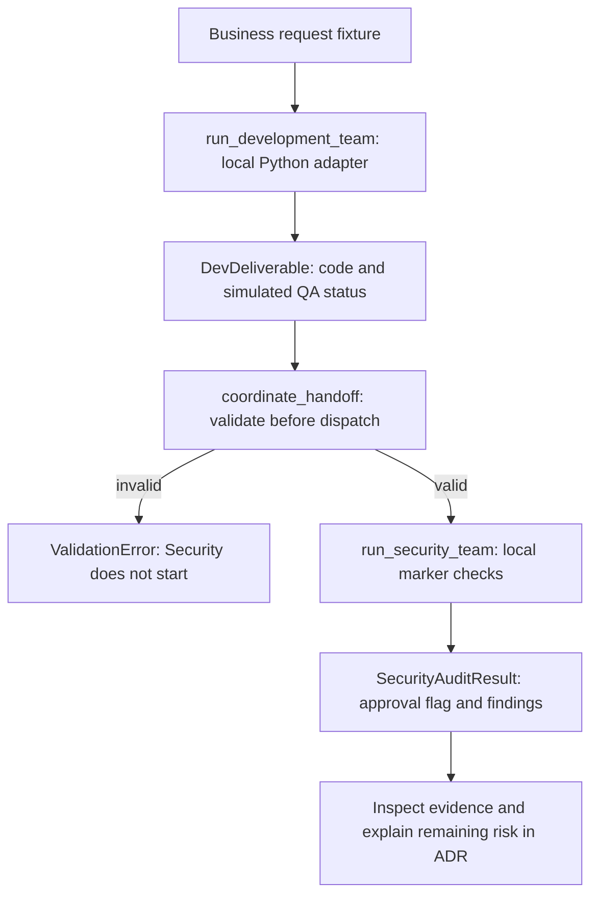
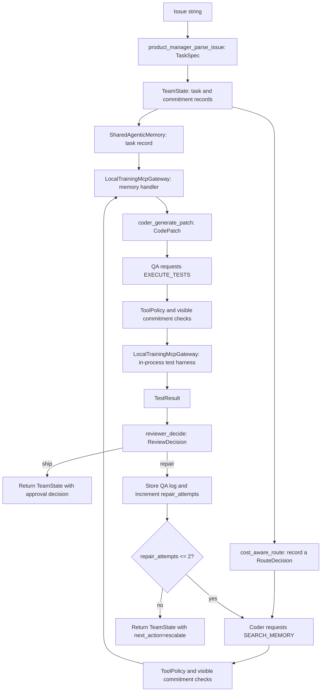

# Archived Deterministic Reference Architecture

This reference is outside the required two-day course. For the current learner route, use the [course map](../COURSE_MAP.md), [notebook manifest](../notebooks/notebook_manifest.yml), and [Capstone brief](../assignments/ex5_capstone_virtual_software_company.md).

The earlier diagram combined an optional FastAPI example with the standalone reference module and presented them as one implemented pipeline. The diagrams below separate those implementations. A status such as `ship` is a decision value in a teaching fixture; it does not deploy software or create a pull request.

## Current course: Development to Security

The [current Capstone notebook](../notebooks/04_capstone_dev_to_security.ipynb) constructs two CrewAI configurations but runs ordinary Python adapters by default. Learners repair the marked contract, coordinator, and Security tool settings.

This describes the **repaired** learner solution. The distributed starter intentionally has incomplete controls. Notebook cell 13 defines Development and Security Crews separately; only the optional live branch in cell 15 calls `kickoff()`. The required path does not run a live model, deploy code, execute a real penetration test, or implement an automatic repair cycle between teams. Lab 3 separately demonstrates one initial attempt plus three retries.

## Retained module: one deterministic team simulation

The standalone [reference module](../src/enterprise_agent_team.py) implements `run_virtual_software_company()`. Its Product Manager, Coder, and QA are `AgentIdentity` records used by ordinary Python functions. The router and reviewer are functions, not extra CrewAI agents.

### What this module implements

- Strict data models for tasks, patches, identities, tool messages, and review decisions.
- A local gateway with handlers for `SEARCH_MEMORY` and `EXECUTE_TESTS`.
- Scope/clearance checks and a small text-based commitment check before handler execution. Authorization failures raise `PermissionError`; handler failures return `ToolResult(ok=False)` and the coordinator raises `RuntimeError`.
- Memory retrieval filtered by clearance and matching words/tags.
- A recorded routing recommendation. The recommendation does not invoke a different model or change the Coder implementation.
- A deterministic first patch that subtracts, followed by a repair that adds. The loop permits at most an initial attempt and two repairs, distinct from Lab 3's three-retry exercise.

The test harness executes its supplied fixture in the current Python process. Restricted built-ins are a teaching convenience, **not a security sandbox**. The module has no FastAPI gateway, task-status store, MCP transport, deployed release, or separate Security Team. Extra role/tool enum values do not mean those roles or handlers run in this workflow.

## Optional API study

The [API-boundary extension notebook](../extensions/08_api_boundaries_async_orchestration.ipynb) is a separate post-course example. Its [optional dependencies](../requirements-api.txt) are not needed for the required labs. It should not be drawn as an entry point to `run_virtual_software_company()` unless an integration is actually implemented and verified.

The older [standalone Capstone starter](../assignments/starter_code/ex5_capstone_starter.py) uses a different `run_company()` interface and `PullRequestSummary` model. It is an optional reference, not the required notebook's API. Use the current notebook and brief when assessing the workshop.
