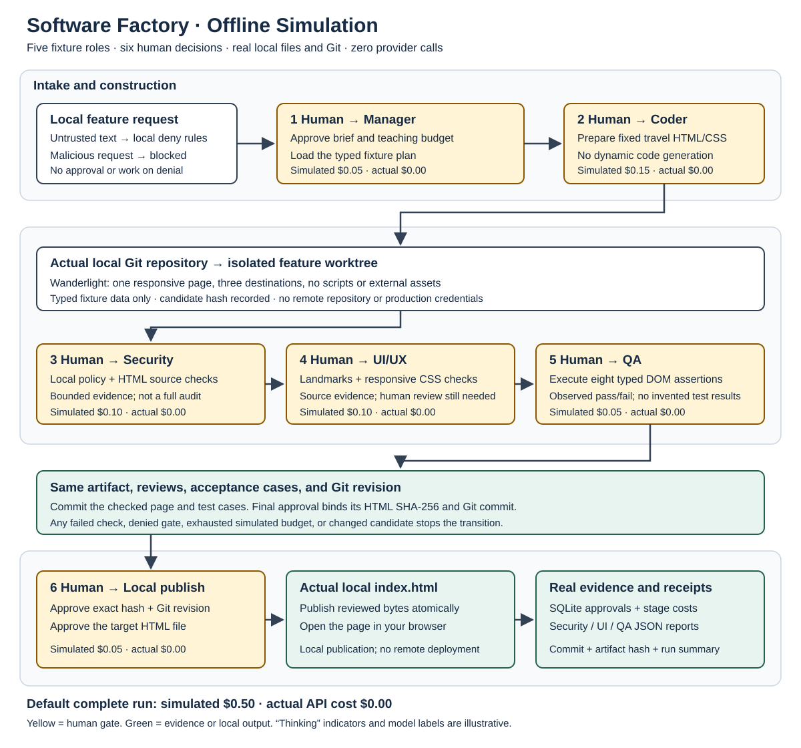

# Software Factory: deterministic live simulation

[Dashboard](../README.md#navigation-dashboard) · [Playbook](../README.md#golden-path) · [Setup](../SETUP.md) · [Factory lab](../notebooks/05_live_software_factory.ipynb) · [Local CI/CD](../notebooks/06_local_cicd.ipynb)

The factory uses pre-generated role outputs, paced terminal collaboration, Pydantic validation, simulated cost tracking, explicit human gates, and real local artifacts. It makes **no API calls**, requires **no API keys**, and has **actual API cost $0.00**. Its historical filename remains stable for existing links.

## Choose your next step

| Goal | Open |
| --- | --- |
| Run the demonstration | [Execution](#live-demo-execution) |
| Understand role labels and budget | [Role/model and cost control](#role-model-and-cost-control) |
| Inspect persisted relationships | [Capstone ERD](../resources/diagrams/capstone_factory_erd.md) |
| Prove malicious requests block | [Security demonstration](#demonstrate-blocking) |
| Repair Git hook stages | [Broken-pipeline exercise](#exercise-fix-the-broken-pipeline) |
| Submit evidence | [Playbook checklist](../README.md#submission-checklist) |

## Architecture and trust boundaries



A travel-site request enters the simulated Engineering Manager/orchestrator. A human approves the plan and teaching budget. Coder writes the supplied HTML/CSS fixture in a separate factory workspace. Security, UI/UX, and QA inspect the candidate with bounded local checks. The human decides at each stage and explicitly authorizes final local publication.

A failed check, denial, missing input, insufficient simulated budget, or changed artifact stops the dependent transition. Review evidence refers to the candidate digest and Git revision. A new artifact needs fresh review/approval evidence. Worktrees and branches separate local work but do not provide an OS sandbox or configure remote branch protection.

<a id="role-model-and-cost-control"></a>

## Role/model and cost control

The model names below come from the scenario as illustrative historical role labels. No model engine or provider runs behind them. “Thinking” animation is presentation pacing. Actual local checks and file/Git operations run normally.

| Role | Illustrative model label | Fixture responsibility | Simulated cost |
| --- | --- | --- | ---: |
| Engineering Manager / Orchestrator | GPT-4 | Plan, route, request human decisions | $0.05 |
| Coder | Claude 3.5 | Supply the travel-site candidate | $0.15 |
| Security Reviewer | GPT-4 Turbo | Return findings from bounded checks | $0.10 |
| UI/UX Reviewer | GPT-4 Vision | Check selected structure and design criteria | $0.10 |
| QA Auditor | GPT-3.5 | Produce test cases and inspect local results | $0.05 |
| Local publication | Local operation | Publish the approved candidate file | $0.05 |
| **Total** | **Actual API cost $0.00** | **Default teaching plan** | **$0.50 simulated** |

Inspect [simulation_config.json](../software_factory/simulation_config.json) for the configured amounts and budget. The ledger checks the remaining simulated allowance before a step and records its amount after the approved work runs. It is a cost-control exercise rather than provider billing. Lower the simulated allowance to prove the stop path; changing a configured budget still requires the relevant human decision.

## Live demo execution

In the activated course environment, from the repository root:

```bash
python orchestrator.py --check-only
python orchestrator.py --security-demo
python live_simulation_orchestrator.py
```

The normal command displays role collaboration with configurable delays. Review each gate for plan/spend, code build, Security, UI/UX, QA, and final local publication. `python orchestrator_with_approval.py` remains a compatible entry point.

```bash
python live_simulation_orchestrator.py --mode replay --delay-seconds 0
```

Replay uses the same fixtures without presentation pacing. `--mode live` is rejected. `--no-input` fails closed at approval. Automated tests may inject an explicitly named fixture actor; that is test evidence rather than human approval.

After the final human approves the current candidate:

```bash
open index.html
```

On other systems, use the browser's file-open command. The page, test cases, review reports, SQLite records, and Git candidate are actual local artifacts. Inspect paths printed by the run under `output/software-factory`. The root `index.html` represents a local publication, with no remote host, deployment environment, or production URL.

## Demonstrate blocking

The supplied adversarial request asks to store passwords in `localStorage` and send them to `http://evil.com/api/login`. Run the local security demonstration:

```bash
python orchestrator.py --security-demo
```

Expected findings include insecure HTTP, password storage in browser storage, and potential data exfiltration. The request must block before publication. No request reaches that endpoint. Inspect the actual findings rather than accepting a hardcoded “approved” banner.

Security checks cover selected dangerous patterns. UI/UX checks cover declared structural/design criteria. QA checks the supplied acceptance assertions. They do not establish absence of all vulnerabilities, browser performance, or WCAG conformance. The current site is static and implements no password or booking service.

## Connect back to the labs

| Foundation | Factory application |
| --- | --- |
| Lab 1 typed output | Validate fixture results before the next owner acts |
| Lab 2 roles and context | Keep Coder, reviewers, and human decisions separate |
| Lab 3 bounded attempts | Stop on invalid input, exhausted teaching budget, or repeated failure |
| Capstone handoff | Bind review and approval evidence to the exact candidate |
| Local CI/CD | Recheck the candidate and publish only after the final human decision |

## Local setup in a disposable repository

**Prerequisites:** Bash, Git with `git init -b` support, Python 3, and an installed Semgrep CLI on `PATH`. Use a separate instructor-tested scanner environment and record its exact version; follow the [official Semgrep installation instructions](https://semgrep.dev/docs/getting-started/quickstart) if needed. Use the supplied notebook 06 checks when Semgrep is unavailable; the separate hook exercise needs an installed scanner.

For a one-shot setup, use the [downloadable local bootstrap script](software_factory/setup-local-factory.sh). From the course repository root, run `bash extensions/software_factory/setup-local-factory.sh`. It checks prerequisites and creates the toy repository, both corrected hooks, and two branch worktrees under `/tmp`. It installs no dependencies and connects no provider, remote repository, or deployment target. Copy its printed `cd` command into your shell, then go directly to [Prove the behavior](#prove-the-behavior); skip the inline setup and hook-installation blocks below. The script bootstraps this local gate exercise only, the separate hook exercise.

Alternatively, run the following blocks in the **same Bash session**, outside the course checkout. They create a temporary sibling layout with a repository and two worktrees. They do not clone a template or configure a remote. `git init` creates no GitHub protection; protection is configured separately on the remote service.

```bash
set -eu
command -v git
command -v python3
command -v semgrep
git --version
semgrep --version

factory_workspace=$(mktemp -d "${TMPDIR:-/tmp}/software-factory.XXXXXX")
mkdir "$factory_workspace/repo"
cd "$factory_workspace/repo"
git init -b main
git config user.name "Factory Exercise"
git config user.email "factory-exercise@example.invalid"
git config commit.gpgsign false
git config core.hooksPath .githooks
mkdir .githooks app

cat > .gitignore <<'EOF'
.env
.env.*
!.env.example
.venv/
__pycache__/
evidence/
EOF
cat > backlog.md <<'EOF'
# Local exercise queue
- [ ] FEAT-001: Add a safe numeric conversion helper
- [ ] FEAT-002: Add a second acceptance test

Budget and deployment services are not connected.
EOF
cat > app/calculate.py <<'EOF'
def parse_integer(text: str) -> int:
    return int(text)
EOF
cat > .semgrep.yml <<'EOF'
rules:
  - id: teaching-no-eval
    languages: [python]
    message: Do not evaluate supplied expressions; use a narrow parser.
    severity: ERROR
    pattern: eval(...)
EOF
git add .gitignore backlog.md app/calculate.py .semgrep.yml
git commit -m "Initialize disposable factory exercise"
```

The initial commit gives worktrees a valid base. `.githooks` is configured before it contains hooks; the following exercise installs the policy. The one-rule configuration detects the deliberate `eval` fixture only. It is not a complete application security policy.

## Exercise: Fix the Broken Pipeline

**Scenario:** a proposed `pre-commit` hook checks a root-level `COMMIT_EDITMSG` and blocks a valid reviewed commit. Its proposed repair treats a successful Semgrep scan as a vulnerability and allows a metadata marker to skip scanning.

**Outcome:** identify the two independent gates, repair the hook stages, and prove clean commits pass while missing metadata, findings, and scanner errors block. This supports the integrated CI/CD lab. Completing it demonstrates local commit behavior; the main factory separately demonstrates actual local publication.

Git calls `pre-commit` before obtaining the candidate message; it receives no message-file parameter. `commit-msg` receives that file as `$1`. Do not guess `.git/COMMIT_EDITMSG`, especially in a linked worktree. Hooks may be bypassed, so they provide local feedback rather than remote enforcement. See [Git hooks](https://git-scm.com/docs/githooks).

### Install the corrected gates

From the disposable `repo` directory, create the metadata hook:

```bash
cat > .githooks/commit-msg <<'EOF'
#!/bin/sh
set -eu
message_file=${1:?Git must supply the candidate message file}
if ! git interpret-trailers --parse "$message_file" |
    grep -Fxq 'Security-Reviewed: true'; then
    echo 'BLOCKED: a Security-Reviewed: true trailer is required.' >&2
    exit 1
fi
exit 0
EOF
```

The trailer is a teaching convention, not proof that an independent person reviewed the change. Real reviewer approval must be authenticated and bound to the candidate revision.

Create the scanning hook. It exports the **staged index** so unstaged edits cannot change what is inspected:

```bash
cat > .githooks/pre-commit <<'EOF'
#!/bin/sh
set -eu
if ! command -v semgrep >/dev/null 2>&1; then
    echo 'BLOCKED: Semgrep is unavailable; activate the scanner environment.' >&2
    exit 2
fi
scan_snapshot=$(mktemp -d)
trap 'rm -rf "$scan_snapshot"' EXIT
trap 'exit 2' HUP INT TERM
git checkout-index --all --prefix="$scan_snapshot/"
if (
    cd "$scan_snapshot"
    semgrep scan --config=.semgrep.yml --error --strict \
        --metrics=off --disable-version-check app
); then
    exit 0
else
    scan_status=$?
    echo "BLOCKED: scanner returned $scan_status; inspect findings or errors." >&2
    exit "$scan_status"
fi
EOF
chmod +x .githooks/pre-commit .githooks/commit-msg
git add .githooks
git commit -m "Add independent scan and message gates" \
    -m "Security-Reviewed: true"

git worktree add -b codex/feat-001 ../feat-001 main
git worktree add -b codex/feat-002 ../feat-002 main
git worktree list
cd ../feat-001
git config --get core.hooksPath
```

For this `semgrep scan --error` invocation, 0 permits the scan gate, 1 means findings, and other nonzero statuses mean a scanner/configuration failure. Every nonzero result blocks. Metadata never bypasses the scan. The local rules file avoids fetching a changing `--config=auto` ruleset. See [Semgrep CLI behavior](https://semgrep.dev/docs/cli-reference).

### Prove the behavior

Run the following from `feat-001`. Each expected rejection leaves the staged change available for the next command. The deliberate finding is scanned, never executed.

```bash
cat > app/calculate.py <<'EOF'
def parse_integer(text: str) -> int:
    return int(text.strip())
EOF
git add app/calculate.py
before_commit=$(git rev-parse HEAD)
if git commit -m "Trim numeric input"; then
    echo 'FAIL: missing metadata was accepted' >&2
    exit 1
fi
test "$(git rev-parse HEAD)" = "$before_commit"

git commit -m "Trim numeric input" -m "Security-Reviewed: true"
clean_commit=$(git rev-parse HEAD)

cat > app/calculate.py <<'EOF'
def parse_integer(text: str) -> int:
    return eval(text)
EOF
git add app/calculate.py
if git commit -m "Deliberate finding fixture" -m "Security-Reviewed: true"; then
    echo 'FAIL: a finding bypassed the scan' >&2
    exit 1
fi
test "$(git rev-parse HEAD)" = "$clean_commit"

git restore --source=HEAD --staged --worktree app/calculate.py
cp .semgrep.yml .semgrep.saved
printf 'rules: [\n' > .semgrep.yml
git add .semgrep.yml
if git commit -m "Deliberate scanner error" -m "Security-Reviewed: true"; then
    echo 'FAIL: invalid scanner configuration was accepted' >&2
    exit 1
fi
test "$(git rev-parse HEAD)" = "$clean_commit"
mv .semgrep.saved .semgrep.yml
git add .semgrep.yml
git diff --cached --exit-code
git status --short
```

Record the actual hook/scanner output for each rejection; a command failing for an unrelated reason is not a pass. Inspect that the first failure names missing metadata, the second reports `teaching-no-eval`, and the third reports invalid configuration. Record `git rev-parse HEAD`, `git rev-parse HEAD^{tree}`, `semgrep --version`, and the `.semgrep.yml` content hash with the clean success. Inspect that `.githooks` exists in both worktrees and each reports `.githooks` as `core.hooksPath`.

For a staged-content check, stage the unsafe fixture, then edit the working file back to the safe form **without staging it**. The commit must still fail because the index contains `eval`. Restore that file from `HEAD` with `git restore --source=HEAD --staged --worktree app/calculate.py` afterwards. This restore command is intended only for the supplied disposable fixture.

**Acceptance evidence:** clean reviewed commit succeeds; missing metadata blocks; findings block even with metadata; invalid/missing scanner blocks; staged unsafe code cannot be hidden by an unstaged safe edit. Preserve screenshots or logs and a short explanation of the wrong hook stage and inverted success condition. No feature has been deployed by this exercise.

## Evidence and governance checklist

- [ ] Simulation mode and actual API cost $0.00 are visible.
- [ ] Human reviewed the scope and simulated budget.
- [ ] Candidate source and Git revision are recorded.
- [ ] Security, UI/UX, and QA checks refer to that candidate.
- [ ] Failed/missing evidence stops the workflow.
- [ ] Final human decision names the artifact to publish locally.
- [ ] Published file digest/receipt matches the approved artifact.

A local hook is feedback, not authenticated independent review. `Security-Reviewed: true` is a teaching marker and must never replace a scan or human decision. Remote production delivery would need separate trusted CI, identity, branch/environment policy, deployment receipts, and target-side tests. This course demonstration configures none of those remote services.

[Return to dashboard](../README.md#navigation-dashboard) · [Capstone ERD](../resources/diagrams/capstone_factory_erd.md) · [Submission checklist](../README.md#submission-checklist)
