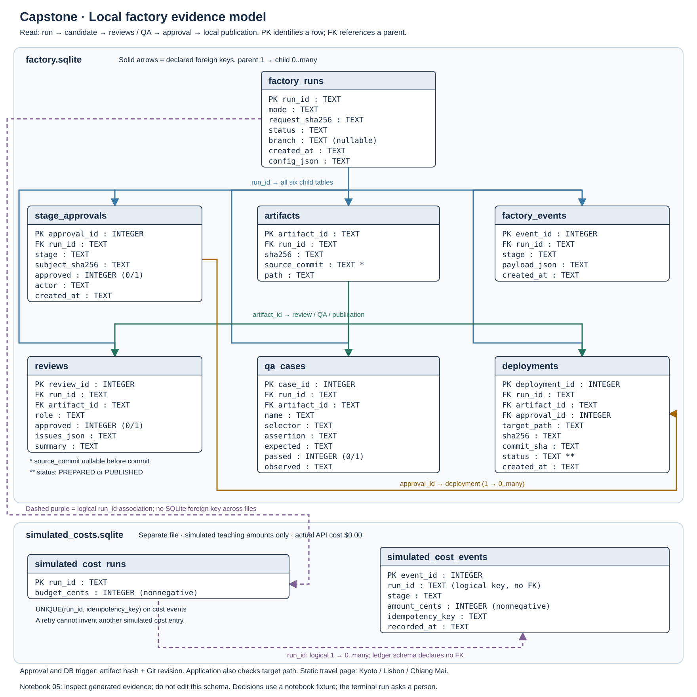
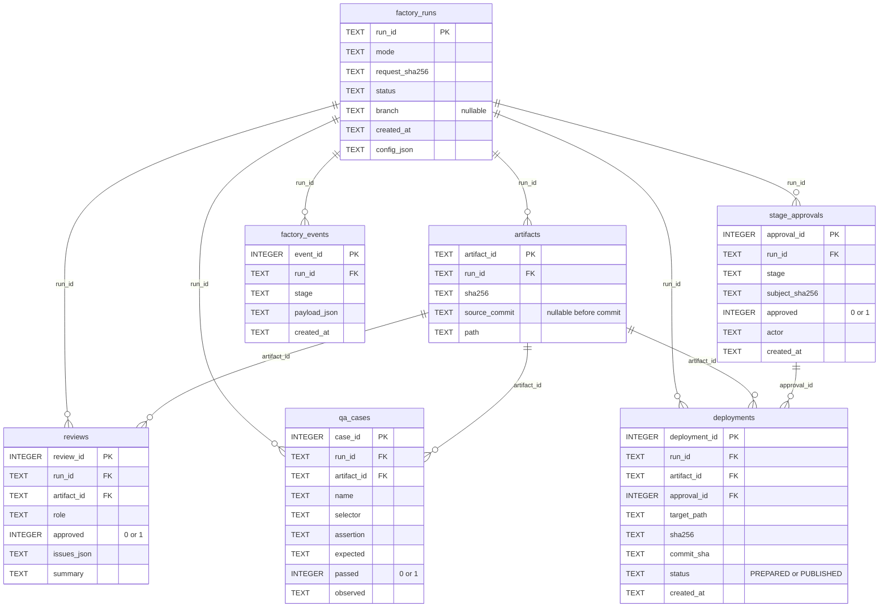
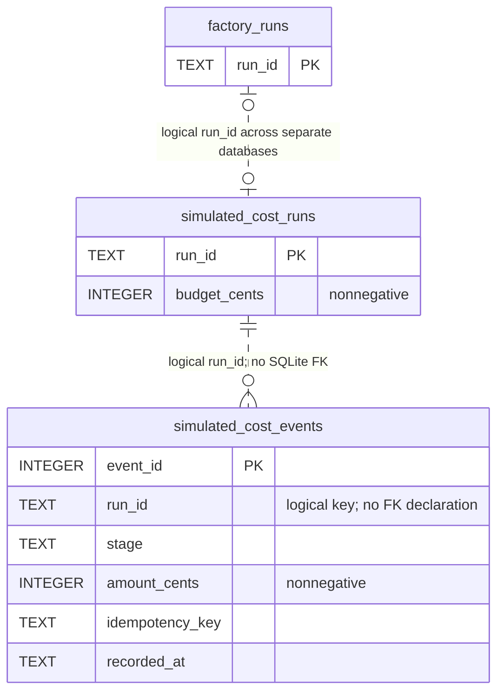

# Capstone ERD: actual local factory evidence

[Course dashboard](../../README.md) · [Capstone exercise](../../ASSIGNMENTS.md#ex5-capstone-virtual-software-company) · [Factory walkthrough](../../extensions/live_software_factory.md) · [Open scalable ERD](capstone_factory_erd.svg)

This model describes the SQLite tables implemented by [the evidence store](../../software_factory/storage.py) and [the simulated cost ledger](../../cost_tracker.py). A successful run builds the fixed **Wanderlight** travel page, records approval decisions, checks the candidate, commits it in a local feature worktree, and publishes an approved local HTML file. Notebook rehearsals label decisions `notebook-fixture`; the terminal run asks a person. There are no model requests or provider charges.

Read the SVG or the tables below; **no diagram package, database viewer, or extra dependency is required**. Mermaid source is also included for viewers that support it.

## What you interact with

In [Notebook 04](../../notebooks/04_capstone.ipynb), repair the Python handoff between Development and Security, then run the supplied API/memory/repair probes. Its task-scoped `review_memory` dictionary is separate from this database and is not a table in the ERD. In [Notebook 05](../../notebooks/05_live_software_factory.ipynb), run the local rehearsal and inspect its candidate, decisions, checks, Git commit, and publication receipt. [Notebook 06](../../notebooks/06_local_cicd.ipynb) exercises the allow/block paths. This ERD explains the rows those factory operations write; **you do not edit the database schema**.

Follow one `run_id` through the evidence. Then follow its `artifact_id` from the candidate to its reviews, QA cases, and publication. The final `approval_id` connects the publication to the exact decision used to authorize it. A stopped run can have no candidate, tests, or publication receipt.

## Evidence database: `factory.sqlite`

`PK` identifies a row; `FK` references a parent row. Solid relationships in the diagrams are declared SQLite foreign keys. Each relationship permits one parent to have zero or more children; the schema does not impose a single deployment per approval.

| Table | What to inspect | Parent reference |
| --- | --- | --- |
| `factory_runs` | Request hash, mode, branch, and current status | Root row: `run_id` |
| `artifacts` | Candidate file path, HTML hash, and Git commit | `run_id` → `factory_runs` |
| `stage_approvals` | Stage, subject hash, yes/no decision, and actor | `run_id` → `factory_runs` |
| `reviews` | Security/UI review result and issues for the candidate | `run_id` → `factory_runs`; `artifact_id` → `artifacts` |
| `qa_cases` | Each assertion, expected/observed result, and pass/fail | `run_id` → `factory_runs`; `artifact_id` → `artifacts` |
| `deployments` | Local target, candidate hash, commit, and receipt status | `run_id` → `factory_runs`; `artifact_id` → `artifacts`; `approval_id` → `stage_approvals` |
| `factory_events` | Recorded stage details, including the full approval request | `run_id` → `factory_runs` |

These are **10 foreign-key relationships**: six children reference the run, three reference the artifact, and publication also references its approval. Here, `deployments` records local HTML publication; it does not describe a hosted service.

`branch` and `source_commit` are nullable during setup; the remaining non-key columns are declared `NOT NULL`. The `approved` and `passed` columns use `CHECK` constraints to accept only `0` or `1`; deployment status accepts only `PREPARED` or `PUBLISHED`. These are the constraints in the current schema.

## Separate simulated-cost database: `simulated_costs.sqlite`

These are teaching units, recorded only after approved work executes. The default five specialist stages total **$0.45 simulated**, followed by **$0.05 simulated** for local publication. Actual API cost remains **$0.00**, with **zero provider calls**. Amounts and the teaching budget come from [the validated offline configuration](../../software_factory/simulation_config.json).

| Table | Stored evidence | Relationship |
| --- | --- | --- |
| `simulated_cost_runs` | One run's teaching allowance | `run_id` logically matches the evidence run |
| `simulated_cost_events` | Executed stage, amount in cents, and retry key | `run_id` logically matches its ledger run |

Dashed relationships mean an application association, **not a declared foreign key**. Default settings are supplied; running the notebooks requires no budget or profile edits.

The ledger enforces `UNIQUE(run_id, idempotency_key)` so retrying a completed stage cannot create another charge entry. Its two `run_id` columns are associated by application logic; the ledger schema declares no foreign key between them. The shared `run_id` also connects the ledger to the evidence database logically. SQLite does not enforce a foreign key across these two files. Ledger setup can precede creation of the corresponding `factory_runs` row.

## What binds a final approval

The final decision approves the candidate's **HTML SHA-256, reviewed Git revision, and local target path**. The deployment receipt records those values and the approval row. [The workflow](../../software_factory/workflow.py) checks the current candidate, committed bytes, worktree state, and destination before publication. A changed candidate or Git revision invalidates earlier review evidence; a changed destination blocks replacing that file.

The foreign keys prove that referenced rows exist. They do **not** by themselves prove that an approval belongs to the same artifact or that hashes match. The additional `publication_requires_matching_approval` SQLite trigger rejects insertion of a receipt unless its approved publication decision, run, artifact hash, and recorded Git commit agree. The workflow also checks the committed bytes and local target. Its approval JSON/event preserves the full request, including commit, target, simulated cost, actor, and decision. A fixture actor remains test evidence rather than a person's identity. This distinction is part of the capstone audit.

## Travel content is static HTML

| Destination | Actual implementation |
| --- | --- |
| Kyoto, Japan | The `article#kyoto` fixture element |
| Lisbon, Portugal | The `article#lisbon` fixture element |
| Chiang Mai, Thailand | The `article#chiang-mai` fixture element |

These three destinations live in [the checked-in travel page](../../software_factory/fixtures/index.html). There is no destination database, booking service, login flow, payment system, or contact form. The ERD models the factory's governance evidence and simulated costs. Keep the exercise focused on orchestration, security, and bounded autonomy: trace the candidate's evidence rather than designing a travel-data system.
